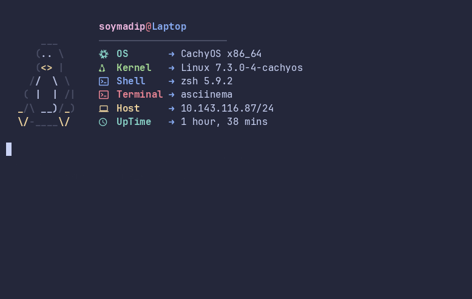

<h1>Quikrun</h1>
<h3>Run your code files without hassle</h3>
<p>Quikrun is a cross platform CLI tool for running code files instantly without typing complex commands in your terminal.</p>

<br clear="all">

## Features

- **Auto language Detection:** Auto-detects language by extension or shebang headers (`#!`).
- **Sane Defaults:** Default command templates preconfigured with generally recommended compiler/interpreter flags.
- **Highly Configurable:** Add new languages or override behavior to suit your own taste
- **Argument Forwarding:** Safely forward arguments/flags to your scripts easily, with support for POSIX `--` separator.
- **Preserves Return Codes:** Catches exist code of your file and returns it gracefully to shell

---

## Installation

### Distro Packages

#### 1. Arch Linux (AUR)

```bash
paru -S quikrun

# or
yay -S quikrun
```

## Via PyPI

If there is not package for your distro/OS, you can install directly:

```bash
# Using uv (highly recommended for global installation)
uv tool install quikrun

# Using pipx (another good way to install globally)
pipx install quikrun

# Using pip (if you wanna install locally in a project)
pip install quikrun
```

## Precompiled binary

Precompiled binaries are available in [Releases](https://github.com/soymadip/quikrun/releases/latest)

---

## Quick Usage

Simply pass your file to `quikrun`:

```bash
quikrun main.py   # runs with python3
quikrun hello.c   # compiles using gcc and runs the binary
```

### Forwarding Arguments

- For simple cases with no flag conflicts:

  ```bash
  quikrun script.py arg1 arg2
  ```

- Use the `--` separator to forcely forward instead of quikrun:

  ```bash
  quikrun script.py -- --verbose --threads 4
  ```

---

## Configuration, IDE Integration

For customization, default commands, IDE Integration, check out our **[Documentation](https://soymadip.github.io/quikrun)**
